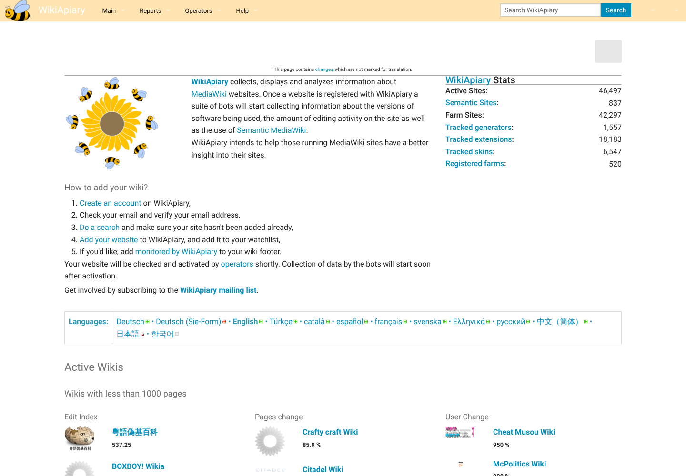
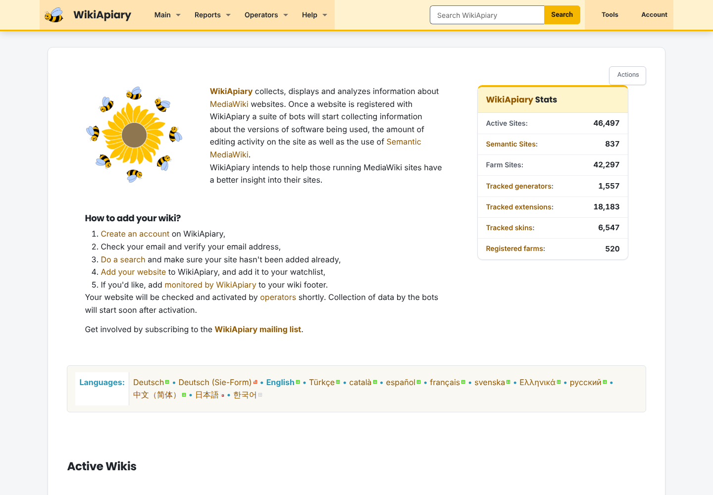
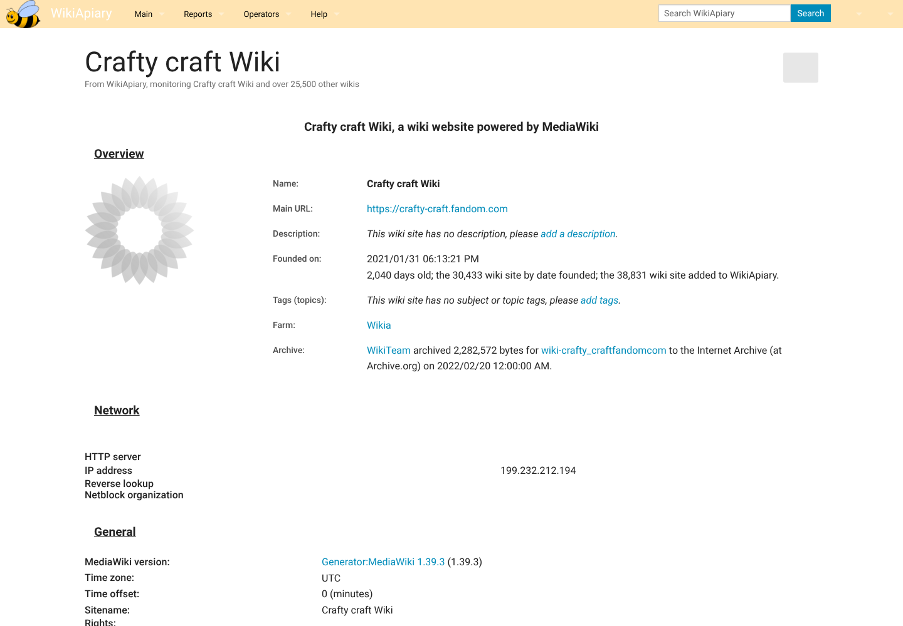
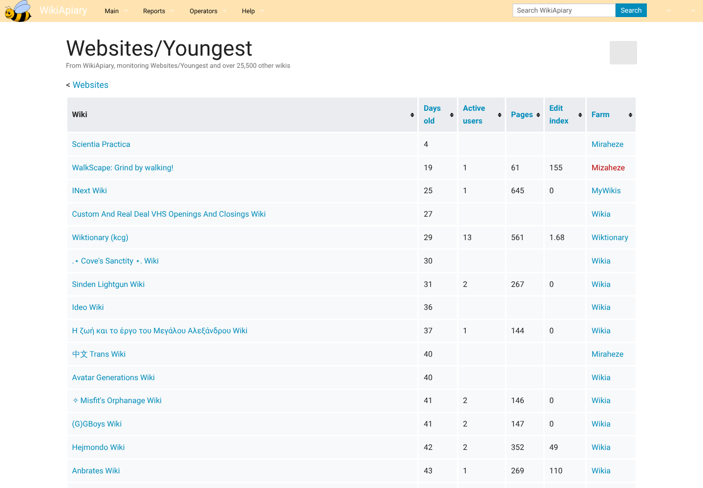
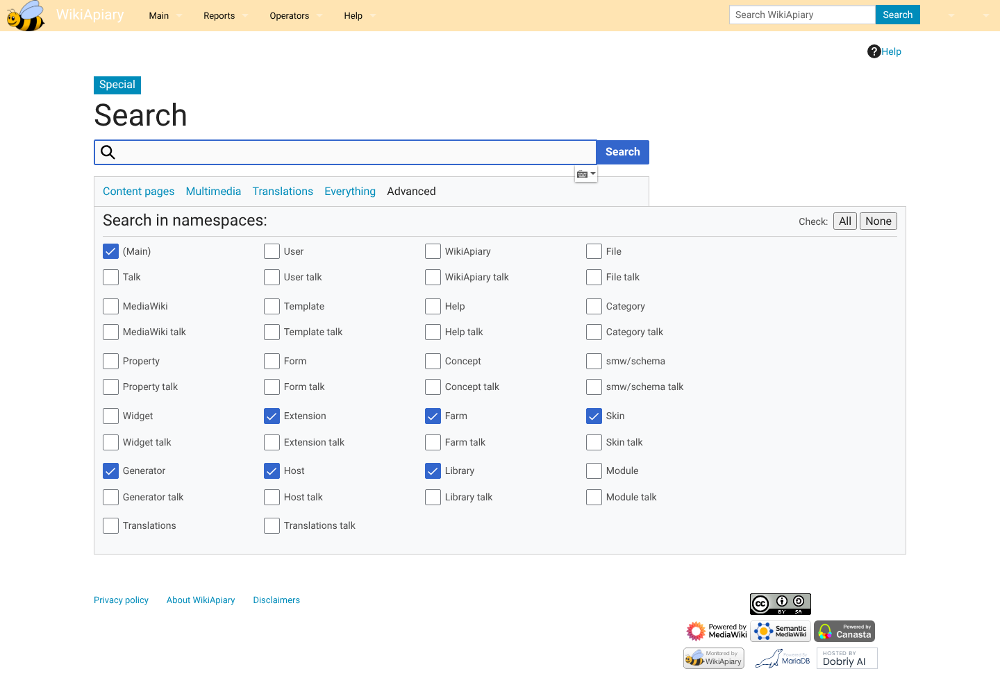
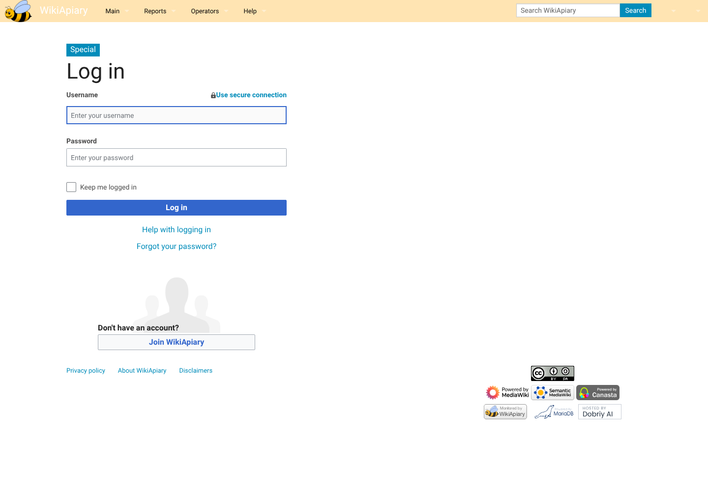
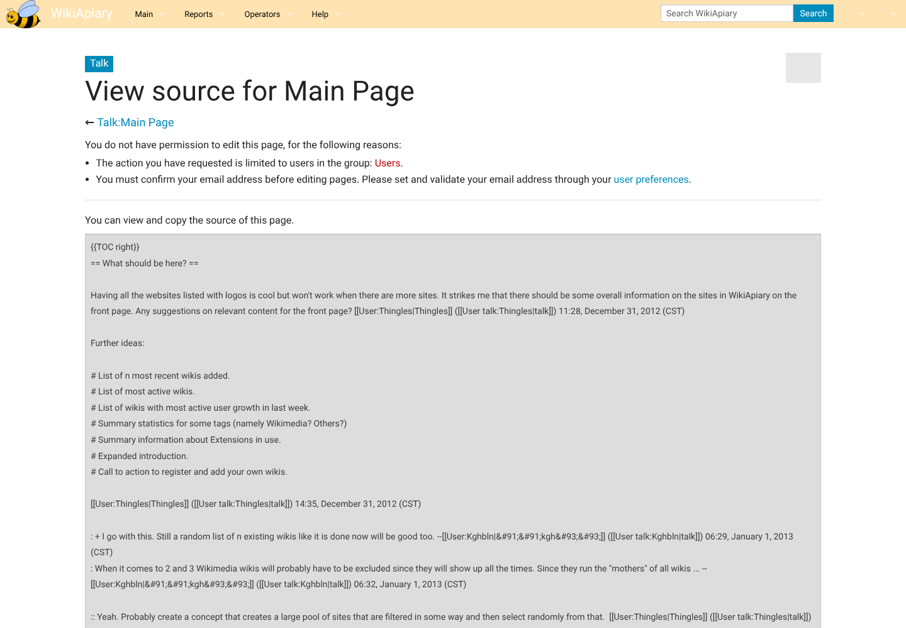

# Foreground modernization

WikiApiary uses a native variant of the existing Foreground skin. Its source is
in `charts/canasta/files/foreground/`, based on the original manifest and PHP
template retained under `legacy/foreground/`. It preserves the skin identifier
`foreground`, the existing page markup, and user skin preferences.

The skin's `skin.json` includes `wikiapiary.css` at the end of the native
`skins.foreground.styles` bundle. MediaWiki links that styles-only bundle in
the document head before rendering. The design works with JavaScript disabled.
There is no late stylesheet injection or mixed CSS/JavaScript presentation module.

Tools and Account labels and their accessibility attributes are rendered by
`Foreground.skin.php`. The separate native script bundle handles navigation
interaction only, including mobile expansion, dropdowns, and keyboard dismissal.
It uses scoped DOM handlers instead of the old Foundation plugins, whose cookie
plugin fails inside MediaWiki's module wrapper. The original Foundation styles
remain part of the skin. The chart mounts the manifest, template, English messages,
CSS, and navigation script over the original skin files. Checksums roll the web
pods whenever these files change, without rebuilding the application image.

The enhancement keeps the bee artwork and honey-colored navigation while
improving navigation states, typography, spacing, tables, forms, focus styles,
and small-screen behavior. On the Main Page it also presents the statistics as
a compact card and suppresses the editor-only stale-translation notice.

## Main Page comparison

### Before

### After

### After on a small screen

## Pre-change reference pages

These screenshots preserve the untouched production Foreground presentation
before the WikiApiary modernization module was deployed. Each capture uses a
1440 × 1000 desktop viewport.

### Main Page

### Wiki detail

### Data listing

### Search

### Login

### Edit or source view

## Maintenance

- Edit `charts/canasta/files/foreground/wikiapiary.css` for visual
  changes.
- Edit `charts/canasta/files/foreground/Foreground.skin.php` for server-rendered
  skin markup. Retain the upstream Foreground license and attribution.
- Edit `charts/canasta/files/foreground/wikiapiary-navigation.js` only for
  navigation behavior. It must not add labels or inject styles.
- Set `foregroundModern.enabled: false` to return to the unmodified Foreground
  presentation.
- Render and validate the production chart before submitting a pull request;
  CI enforces native skin registration, styles-only presentation, server-rendered
  labels, asset mounts, syntax, responsive rules, and Main Page-specific fixes.

After a release, refresh cached HTML on both hostnames and both Varnish replicas.
Existing cached pages reference the removed asynchronous module and must be
regenerated. Verify the initial stylesheet contains the WikiApiary design with
JavaScript disabled, then check desktop and mobile navigation with JavaScript on.
